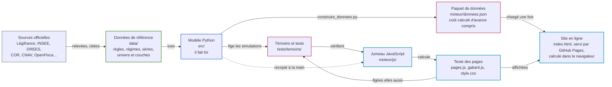
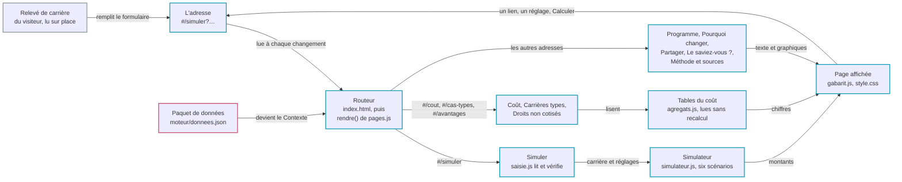
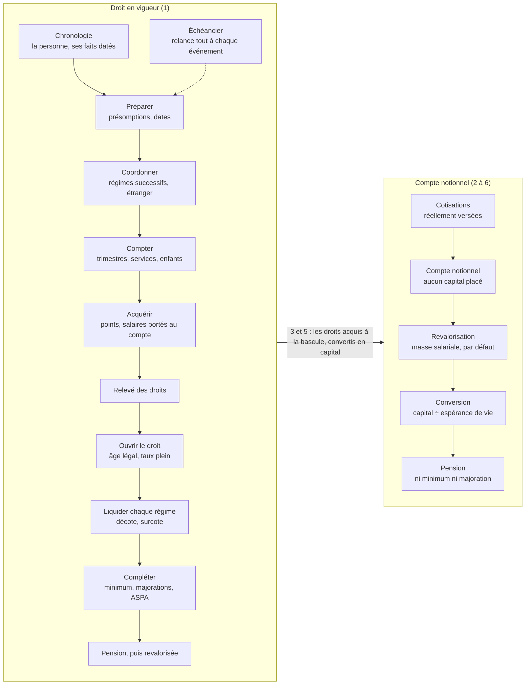
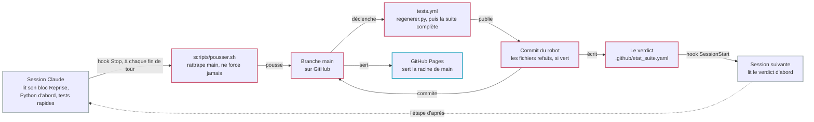

# Carte du dépôt

Une vue d'ensemble, en schémas : d'où viennent les chiffres, ce qui se passe
pendant une visite du site, comment se bâtissent les six scénarios, et comment
un changement arrive en ligne. Elle ne dit rien que d'autres documents ne
disent en détail (l'architecture, `docs/architecture.md` ; le tableau de bord,
`docs/etat.md` ; la feuille de route, `docs/feuille_de_route.md`) : elle est
là pour s'y retrouver, et dit en bas où suivre l'avancement.

Ce n'est pas une page du site : le simulateur ne la charge pas et n'y renvoie
nulle part. Elle reste juste d'elle-même. Ses chiffres sont ancrés, et GitHub
les recalcule à chaque envoi ; `tests/test_carte_du_depot.py` vérifie que les
fichiers qu'elle cite existent, que ses adresses sont celles du site et que
ses scénarios sont ceux de `data/reference/univers/`. Un fichier renommé, une
page ou une couche de plus, et ce test demande à la carte de suivre.

## Les cinq zones

| Zone | Où | Ce qu'on y trouve |
|---|---|---|
| Données | `data/` | Ce que le modèle sait du droit et de l'économie : les fiches de règles, les régimes, les séries, les scénarios. En YAML et en CSV, chaque valeur rattachée à sa source. Consignes : `data/CLAUDE.md`. |
| Modèle | `src/` | Le calcul de référence, en Python. Il fait foi, et toute règle s'y écrit d'abord. Consignes : `src/CLAUDE.md`. |
| Site | `index.html`, `moteur/` | La copie du modèle en JavaScript, le texte des pages, la feuille de style : des fichiers servis tels quels, sans rien à construire. Consignes : `moteur/CLAUDE.md`. |
| Atelier | `scripts/`, `tests/`, `.github/` | Ce qui fabrique et vérifie : le paquet de données, les témoins, les tests, la publication. |
| Hors du dépôt | | Les sources officielles, les visiteurs du site, et les sessions Claude qui font le travail. |

Dans les schémas, le bord d'une boîte dit sa zone : vert pour les données,
bleu pour le modèle, cyan pour le site, rose pour l'atelier, gris hors du
dépôt.

## 1. D'où viennent les chiffres

Le modèle Python lit les données et fabrique deux choses : le paquet que
charge le site, `moteur/donnees.json`
(<!--chiffre:poids(moteur/donnees.json)-->5 617<!--/--> Ko, par
`scripts/construire_donnees.py`), et les témoins qui vérifient la copie
JavaScript, dans `tests/temoins/` (par `scripts/construire_temoins.py`).

La copie elle-même, seul trait en pointillé, se fait à la main, règle par
règle et Python d'abord, sous les mêmes noms d'étapes des deux côtés. Les
témoins la tiennent :
<!--chiffre:entrees(tests/temoins/simulations.json:)-->876<!--/--> simulations
complètes et <!--chiffre:entrees(tests/temoins/pages.json:)-->76<!--/--> pages
figées, que `node --test` rejoue ;
<!--chiffre:portage(valeurs)-->163 052<!--/--> nombres comparés, dont
<!--chiffre:portage(identiques)-->97,3<!--/--> % identiques au bit près.

Une exception, voulue : le coût pour toute la population ne se calcule qu'en
Python. Il voyage tout fait dans le paquet (`data/derive/agregats.json`), et
le site le lit sans le recalculer (`moteur/js/agregats.js`).

## 2. Une visite sur le site

Le site n'a pas de serveur de calcul : `index.html` charge le paquet et le
moteur, et le navigateur du visiteur fait le reste ; rien de ce qu'il saisit
ne quitte sa machine. L'adresse porte toute la simulation : elle se cite et se
partage telle quelle. Les adresses du site sont sa surface publique
(`docs/architecture.md`, annexe C) : elles ne changent pas sans note de
décision, et les anciennes, `#/trajectoire` et `#/donnees`, mènent à ce qui
les a remplacées. Le relevé de carrière déposé par le visiteur se lit dans le
navigateur (`moteur/js/lecture-pdf.js`, `moteur/js/releve-lu.js`), sans rien
envoyer.

| Page | Adresse | Ce qu'elle montre | Calcul |
|---|---|---|---|
| Programme | `#/` | L'accueil : la proposition, ce qu'elle change, les questions d'un électeur. | texte et paquet |
| Simuler | `#/simuler` | Une carrière, saisie ou lue sur le relevé : les montants, le détail du calcul, l'écart décomposé règle par règle. | en direct |
| Coût | `#/cout` | Ce qui rentre, ce qui sort, ce qui manque, et qui paie quoi. | précalculé |
| Pourquoi changer | `#/risque` | Votre retraite sera-t-elle payée, et ce qu'en sait la recherche. | texte et paquet |
| Partager | `#/partager` | Les chiffres du programme, en cartes à partager en image. | texte et paquet |
| Le saviez-vous ? | `#/saviez-vous` | Des règles du système actuel, chacune avec son texte officiel. | texte et paquet |
| Carrières types | `#/cas-types` | La grille des carrières types, génération par génération. | précalculé |
| Droits non cotisés | `#/avantages` | Ce que le système donne sans cotisation, et ce qu'on paie sans rien recevoir. | précalculé |
| Méthode et sources | `#/methode` | Comment le calcul se fait, la fiabilité des séries, les licences. | texte et paquet |

Les pages précalculées montrent toujours la référence : une adresse qui leur
porte d'autres réglages rend la référence, sous un encadré qui le dit.

## 3. Six scénarios, un seul droit réel

Chaque scénario est un univers de droit (`data/reference/univers/`) : le droit
réel, sur lequel la proposition pose des couches (`data/reference/couches/`)
qui retirent, remplacent ou ajoutent des règles. Une variante de la
proposition s'écrit en couche, jamais dans le code, et le moteur refuse ce
qu'il ne sait pas calculer.

| Couche, dans l'ordre où elle se pose | 1 actuel | 2 rétroactif | 3 prospectif | 4 rétroactif et patronal | 5 prospectif et patronal | 6 proposition |
|---|:-:|:-:|:-:|:-:|:-:|:-:|
| `droit_reel` : le droit en vigueur, toutes ses fiches | ● | ● | ● | ● | ● | ● |
| `contributif_seul` : la liquidation fictive à la bascule, sans les droits non cotisés | | | ● | | ● | |
| `valorisation_des_droits_acquis` : le droit réel jusqu'à la bascule, puis ses droits convertis en capital | | | ● | | ● | |
| `comptes_notionnels` : les cotisations portées au compte, revalorisées, puis converties en rente | | ● | ● | ● | ● | ● |
| `part_patronale` : la cotisation de l'employeur portée au compte avec celle du salarié | | | | ● | ● | ● |
| `taux_unique` : <!--chiffre:mesure(parametre?nom=taux_cotisation_liberal)-->18<!--/--> % pour tous, à compter de la bascule | | | | | | ● |
| `capitalisation_obligatoire` : <!--chiffre:mesure(parametre?nom=taux_capitalisation_obligatoire)-->5<!--/--> points obligatoires et <!--chiffre:mesure(parametre?nom=taux_capitalisation_volontaire)-->5<!--/--> volontaires, capitalisés | | | | | | ● |
| `garantie_vieillesse` : la garantie qui remplace le minimum vieillesse | | | | | | ● |
| `age_legal_de_la_proposition` : l'âge légal des départs à compter de la bascule | | | | | | ● |

Lecture : le scénario 4 est le droit réel, plus les comptes notionnels, plus
la part patronale. L'ordre compte : posée au-dessus de la valorisation des
droits acquis, la couche des comptes notionnels n'agit qu'à compter de la
bascule, en <!--chiffre:mesure(parametre?nom=annee_bascule)-->2026<!--/-->
par défaut. C'est toute la différence entre le 2, rétroactif depuis
l'origine, et le 3, prospectif.

### Deux façons de calculer une pension

À gauche, le droit en vigueur : on construit le relevé des droits, puis on
liquide, en lisant à chaque étape les fiches de la carte des règles
(`data/reference/regles/`) dans leur version en vigueur. Chaque étape est un
module, sous le même nom en Python (`src/retraite_notionnelle/droit/`) et en
JavaScript (`moteur/js/droit/`). À droite, le compte notionnel : ce qui a été
cotisé, revalorisé, puis divisé par l'espérance de vie au départ
(`src/retraite_notionnelle/moteur/`, `moteur/js/compte.js`). La garantie du
scénario 6 vient s'y ajouter.

## 4. D'une session à la mise en ligne

Plusieurs sessions travaillent en parallèle, chacune sur sa zone, et publient
toutes sur `main` par `scripts/pousser.sh`, que le hook Stop lance à chaque
fin de tour (`.claude/settings.json`). Personne ne régénère à la main avant
d'envoyer : à chaque envoi, `.github/workflows/tests.yml` refait sur le
dernier `main` tout ce qui se fabrique (`scripts/regenerer.py`), puis lance
la suite complète ; `scripts/publier_fabrique.sh` commite le résultat sous
`github-actions[bot]` : les fichiers refaits si la suite est verte, le
verdict dans tous les cas. GitHub Pages sert la racine de `main` telle
quelle. Deux autres courses, à heure fixe, ne touchent pas à `main` :
`.github/workflows/index-dila.yml` tient l'index des textes de loi,
`.github/workflows/documents-apportes.yml` publie les documents que leur
licence permet de rediffuser.

## Suivre où en est le projet

Quatre endroits, dans cet ordre :

1. **Le verdict de la suite**, `.github/etat_suite.yaml` : écrit par GitHub
   après chaque envoi, affiché à l'ouverture de chaque session. Rouge, il se
   répare avant tout le reste.
2. **Le tableau de bord**, `docs/etat.md` : refait par GitHub à chaque envoi
   (`scripts/tableau_de_bord.py`). Sa partie 1 dit où l'on en est, la 2 ce
   qui ne va pas encore, la 3 les actions en cours et par quoi commencer.
3. **Les blocs « Reprise »** : `python scripts/reprise.py` imprime, pour
   chaque action en cours de la feuille de route, où elle en est et par quoi
   reprendre, avec la liste de ses notes ; `python scripts/reprise.py 138`
   pour une seule.
4. **Les notes d'étape**, `docs/feuille_de_route/<action>/` : une par étape,
   datée. Les actions closes passent dans `docs/archives/`.

L'inventaire compte
<!--chiffre:entrees(data/reference/regimes/inventaire.yaml:inventaire)-->114<!--/-->
régimes : <!--chiffre:entrees(data/reference/regimes/inventaire.yaml:inventaire?couverture=modelise)-->36<!--/-->
modélisés, <!--chiffre:entrees(data/reference/regimes/inventaire.yaml:inventaire?couverture=partiel)-->44<!--/-->
partiels, <!--chiffre:entrees(data/reference/regimes/inventaire.yaml:inventaire?couverture=a_modeliser)-->9<!--/-->
à modéliser, <!--chiffre:entrees(data/reference/regimes/inventaire.yaml:inventaire?couverture=hors_champ)-->23<!--/-->
hors champ et <!--chiffre:entrees(data/reference/regimes/inventaire.yaml:inventaire?couverture=routage)-->2<!--/-->
routages. Les autres comptes, ceux des fiches de règles et de leurs exemples
officiels, sont dans la partie 1 du tableau de bord.

## Où lire quoi

| Pour savoir… | Lire | Ou lancer |
|---|---|---|
| ce que le modèle calcule, et ce qu'il trouve | `README.md` | |
| comment le dépôt est construit, et où va chaque chose | `docs/architecture.md` : « L'essentiel », § 13, annexe C | |
| où en est le dépôt, ce qui ne va pas, ce qui reste | `docs/etat.md` | `python scripts/tableau_de_bord.py` |
| ce qui est en cours, et par où reprendre | `docs/feuille_de_route.md`, le bloc « Reprise » de chaque action | `python scripts/reprise.py` |
| ce qu'une session a fait | `docs/feuille_de_route/<action>/` | `git log` |
| ce que le modèle ne calcule pas | `docs/limites.md` et `docs/limites/` | |
| comment le scénario 1 reste le droit en vigueur | `docs/veille_droit.md`, et `data/reference/legislation/journal_de_veille/` | `python scripts/veille_droit.py` |
| combien coûte la proposition | `docs/chiffrage_plf.md`, fabriqué | `python scripts/chiffrage_plf.py` |
| si la suite de tests est verte | `.github/etat_suite.yaml` | |
| les règles que suivent les sessions | `CLAUDE.md`, puis `src/CLAUDE.md`, `moteur/CLAUDE.md`, `data/CLAUDE.md` | |
| ce qui a été fait et clos | `docs/archives/` | |

## Le vocabulaire du dépôt

- **Scénario 1, l'étalon** : le droit en vigueur à la date d'effet de la
  pension, tel que la caisse l'applique. Les cinq autres scénarios s'y
  comparent.
- **Fiche** : une règle du droit, dans `data/reference/regles/`, avec ses
  versions datées, les textes qui la fondent et ses exemples officiels.
- **Univers de droit, couche** : un scénario, c'est le droit réel plus des
  couches qui retirent, remplacent ou ajoutent des règles (partie 3).
- **La bascule** : l'année où la proposition entre en vigueur, réglable.
- **Relevé des droits** : ce qu'une demande de pension fait valoir (durées,
  points, salaires portés au compte), avant qu'on la liquide.
- **Liquider** : calculer la pension à sa date d'effet : ouvrir le droit,
  liquider chaque régime, compléter.
- **Échéancier** : il parcourt les événements d'une vie dans l'ordre des
  dates, et relance le calcul à chacun.
- **Jumeau** : la copie JavaScript du modèle, étape par étape et sous les
  mêmes noms.
- **Paquet** : `moteur/donnees.json`, toutes les données que le site charge,
  coût précalculé compris.
- **Témoin** : un résultat figé, simulation ou page, que la copie doit
  retrouver à l'identique.
- **Fichier fabriqué** : un fichier qu'un script écrit, jamais une personne :
  le paquet, les témoins, `docs/etat.md`, les tableaux du README. GitHub les
  refait après chaque envoi.
- **Chiffre ancré** : un nombre de la prose encadré d'un commentaire
  `<!--chiffre:…-->`, qu'une sonde recalcule à chaque fabrication.
- **Bloc « Reprise »** : les dix lignes au plus qui ouvrent chaque action en
  cours : où elle en est, par quoi reprendre.
- **Noyau** : les principes et les contrats de données (`docs/architecture.md`,
  § 13 et annexe C). Il ne change que par une décision écrite.
- **Présomption** : ce que le modèle suppose quand on ne le lui dit pas, par
  exemple des enfants nés aux
  <!--chiffre:valeur(data/reference/vocabulaire/valeurs.yaml:listes.presomptions.valeurs.naissance_des_enfants.valeur)-->30<!--/-->
  ans de l'assuré, et qu'il affiche toujours.
